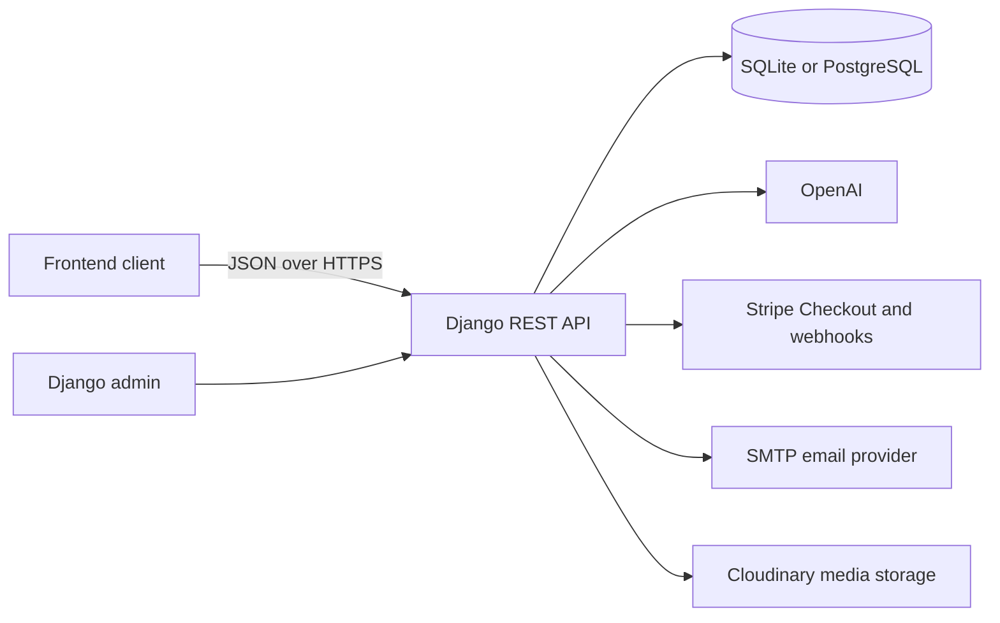

# ExamBuilder API


ExamBuilder API is the Django REST backend for an exam-practice application supporting A-level Biology and GCSE Science. It provides a curriculum catalogue, AI-generated exam-style questions, answer marking, session history and performance tracking, account management, email verification, and qualification-specific paid access through Stripe.

The API is consumed by a separate frontend application. Django admin is included for managing users, entitlements, and curriculum data.

## Contents

- [Features](#features)
- [Technology](#technology)
- [Architecture](#architecture)
- [Getting Started](#getting-started)
- [Configuration](#configuration)
- [Authentication](#authentication)
- [API Reference](#api-reference)
- [Data Model](#data-model)
- [Question Generation and Marking](#question-generation-and-marking)
- [Plans and Stripe Billing](#plans-and-stripe-billing)
- [Django Admin](#django-admin)
- [Curriculum Backups](#curriculum-backups)
- [Testing](#testing)
- [Deployment](#deployment)

## Features

- Email/password registration and JWT authentication.
- Refresh-token rotation and logout token blacklisting.
- Email verification and password-reset flows using signed Django tokens.
- A-level Biology question generation for OCR, AQA, and Edexcel specifications.
- GCSE Science question generation for Biology, Chemistry, Physics, and Combined Science at Foundation or Higher tier.
- AQA A-level Biology 25-mark essay question generation and marking.
- AI-powered marking for individual or batches of answers, including per-answer feedback and session-level strengths and improvements.
- Local fallback question banks used when generated questions are duplicated or unsuitable.
- Per-user served-question tracking to reduce repeated questions for the same curriculum scope.
- Saved question sessions, scores, feedback, and result history.
- A soft reset for performance tracking plus permanent deletion of saved results.
- Free daily question allowance, with separate GCSE and A-level paid unlocks.
- Stripe Checkout and webhook-driven entitlement updates.
- Django admin for curriculum, users, daily usage, and billing records.
- Curriculum-only export command for safe backups and restoration.

## Technology

| Area | Technology |
| --- | --- |
| Language | Python 3.11 |
| Framework | Django 5.2 and Django REST Framework |
| API authentication | `djangorestframework-simplejwt` |
| AI services | OpenAI Python SDK, using `gpt-4.1-mini` |
| Payments | Stripe Checkout and Stripe webhooks |
| Development database | SQLite |
| Production database | PostgreSQL-compatible database via `DATABASE_URL` |
| Media storage | Cloudinary |
| Static files | WhiteNoise |
| Cross-origin access | django-cors-headers |
| Production server | Gunicorn |
| Deployment target | Heroku-compatible platform |

Pinned package versions are listed in [requirements.txt](requirements.txt).

## Architecture



The project has two application modules:

- `accounts`: custom user model, authentication, email flows, user entitlements, Stripe integration, and daily question-usage records.
- `examquestions`: curriculum hierarchy, question generation, AI marking, fallback question banks, served-question history, and saved sessions.

Routes are mounted in [exambuilder/urls.py](exambuilder/urls.py): account endpoints begin with `/accounts/`, while question and curriculum endpoints begin with `/api/`.

## Getting Started

### Prerequisites

- Python 3.11 or newer.
- An OpenAI API key for question generation and marking.
- Optional local service credentials for Cloudinary, SMTP, and Stripe. The application can be migrated and administered without them, but the related features will not function.

### Installation

Clone the repository, then create and activate a virtual environment.

```powershell
git clone <repository-url>
Set-Location exambuilderbe
python -m venv .venv
.\.venv\Scripts\Activate.ps1
pip install -r requirements.txt
```

Create a `.env` file in the project root. Start with the minimum local configuration below.

```dotenv
SECRET_KEY=replace-with-a-long-random-value
DEBUG=True
USE_LOCAL_DB=True
OPENAI_API_KEY=your-openai-api-key
FRONTEND_URL=http://localhost:3000
```

Apply migrations and start the development server:

```powershell
python manage.py migrate
python manage.py runserver
```

The API is available at `http://127.0.0.1:8000/` and Django admin at `http://127.0.0.1:8000/admin/`.

Create an administrator account when required:

```powershell
python manage.py createsuperuser
```

### Local Database Safety

Local development defaults to SQLite in `db.sqlite3`, even when `DATABASE_URL` is present in the environment.

- `USE_LOCAL_DB=True` uses local SQLite.
- On a Heroku dyno, `USE_LOCAL_DB` defaults to `False` because `DYNO` is set, so the app uses `DATABASE_URL`.
- To intentionally access a remote database from a local machine, set `USE_LOCAL_DB=False`.

This protects production data while developing schema changes locally. Run `python manage.py migrate` locally before pointing a deployment at a production database.

## Configuration

Do not commit `.env`, database URLs, API keys, Stripe keys, or SMTP passwords. Configure secrets in the deployment platform instead.

| Variable | Required | Purpose |
| --- | --- | --- |
| `SECRET_KEY` | Yes | Django cryptographic signing key. |
| `DEBUG` | Local only | Enables Django debug mode when set to `true`, `1`, `yes`, or `on`. |
| `USE_LOCAL_DB` | Local recommended | Forces SQLite when true; set false to use `DATABASE_URL`. |
| `DATABASE_URL` | Production | PostgreSQL-compatible connection URL. SSL is required by the production configuration. |
| `OPENAI_API_KEY` | AI features | OpenAI API key for generating and marking questions. |
| `FRONTEND_URL` | Recommended | Base URL used for default reset, verification, and checkout redirect URLs. |
| `EMAIL_VERIFICATION_URL` | Optional | Verification page URL; defaults to `FRONTEND_URL/verify-email`. |
| `PASSWORD_RESET_URL` | Optional | Reset page URL; defaults to `FRONTEND_URL/reset-password`. |
| `DEFAULT_FROM_EMAIL` | Email features | Sender address for verification and reset emails. |
| `EMAIL_BACKEND` | Email features | Django email backend. Console email is used locally when `DEBUG=True`. |
| `EMAIL_HOST`, `EMAIL_PORT` | SMTP | SMTP server and port. |
| `EMAIL_HOST_USER`, `EMAIL_HOST_PASSWORD` | SMTP | SMTP credentials. |
| `EMAIL_USE_TLS` | SMTP | Enables TLS; defaults to true. |
| `CLOUDINARY_URL` | Media uploads | Cloudinary connection URL. |
| `STRIPE_SECRET_KEY` | Billing | Stripe server-side secret key. |
| `STRIPE_PUBLISHABLE_KEY` | Billing | Included in Checkout-session responses for the client. |
| `STRIPE_WEBHOOK_SECRET` | Billing | Verifies Stripe webhook signatures. |
| `STRIPE_PRICE_ID_GCSE` | Billing | Stripe price for GCSE Science access. |
| `STRIPE_PRICE_ID_ALEVEL` | Billing | Stripe price for A-level Biology access. |
| `STRIPE_PRICE_ID_BOTH` | Billing | Stripe price that unlocks both qualifications. |
| `STRIPE_PRICE_ID` | Optional legacy fallback | Used when a qualification-specific Stripe price is not set. |
| `STRIPE_CHECKOUT_MODE` | Optional | `payment` by default; `subscription` is also supported. |
| `STRIPE_SUCCESS_URL`, `STRIPE_CANCEL_URL` | Optional | Checkout redirect URLs; default to account pages under `FRONTEND_URL`. |
| `APP_ENV` | Optional | Defaults to `production`. Set to `staging` to enable the staging safeguards below. |
| `EXTRA_ALLOWED_HOSTS` | Optional | Comma-separated hostnames appended to `ALLOWED_HOSTS` (for example the staging Heroku hostname). |
| `EXTRA_CSRF_TRUSTED_ORIGINS` | Optional | Comma-separated HTTPS origins appended to `CSRF_TRUSTED_ORIGINS`. |

`ALLOWED_HOSTS` and `CSRF_TRUSTED_ORIGINS` start from the production values in [exambuilder/settings.py](exambuilder/settings.py); use `EXTRA_ALLOWED_HOSTS` and `EXTRA_CSRF_TRUSTED_ORIGINS` to add other deployments without editing code.

### Staging Environment

When `APP_ENV=staging`, startup fails with `ImproperlyConfigured` if:

- `SECRET_KEY` is missing. Use a value different from production.
- `DATABASE_URL` is missing. Point it at the staging database only.
- `USE_LOCAL_DB` is enabled (or defaults to enabled because no `DYNO` is set). Set `USE_LOCAL_DB=false`.
- `STRIPE_SECRET_KEY` is set but does not start with `sk_test_`. Leaving it unset is allowed; Stripe checkout and webhooks stay unavailable until test credentials are configured.

Example staging config (placeholders only):

```powershell
heroku config:set APP_ENV=staging USE_LOCAL_DB=false DEBUG=false -a <staging-app>
heroku config:set EXTRA_ALLOWED_HOSTS=<staging-app>.herokuapp.com -a <staging-app>
heroku config:set EXTRA_CSRF_TRUSTED_ORIGINS=https://<staging-app>.herokuapp.com -a <staging-app>
heroku config:set EMAIL_BACKEND=django.core.mail.backends.console.EmailBackend -a <staging-app>
```

Set the remaining secrets (`SECRET_KEY`, `DATABASE_URL`, `OPENAI_API_KEY`, Stripe test keys and price IDs, `FRONTEND_URL`) separately, and do not reuse production values for any of them. Always pass `-a <staging-app>` to Heroku commands, including `migrate`.

## Authentication

The API uses JSON Web Tokens. Send the access token with protected requests:

```http
Authorization: Bearer <access-token>
```

Access tokens last 50 minutes. Refresh tokens last one day, rotate on refresh, and are blacklisted on logout.

### Account Endpoints

| Method | Endpoint | Authentication | Description |
| --- | --- | --- | --- |
| `POST` | `/accounts/register/` | No | Creates a user, sends a verification email, and returns JWT tokens. |
| `POST` | `/accounts/login/` | No | Authenticates an existing user and returns JWT tokens. |
| `POST` | `/accounts/logout/` | Yes | Blacklists the supplied refresh token. |
| `POST` | `/accounts/token/refresh/` | No | Exchanges a valid refresh token for a new access token. |
| `GET` | `/accounts/user/` | Yes | Returns the current user and access status. |
| `POST` | `/accounts/email-verification/confirm/` | No | Verifies a tokenized email link. |
| `POST` | `/accounts/email-verification/resend/` | Yes | Sends another verification email when needed. |
| `POST` | `/accounts/password-reset/` | No | Requests a password-reset email. |
| `POST` | `/accounts/password-reset/confirm/` | No | Validates a reset token and replaces the password. |
| `POST` | `/accounts/reset-performance-tracking/` | Yes | Starts a new performance-tracking window without deleting result history. |
| `POST` | `/accounts/billing/create-checkout-session/` | Yes | Creates a Stripe Checkout session. |
| `POST` | `/accounts/billing/webhook/` | Stripe | Receives and verifies Stripe events. |

### Account Request Examples

Register:

```json
{
  "email": "student@example.com",
  "username": "student",
  "password1": "a-secure-password",
  "password2": "a-secure-password"
}
```

Login:

```json
{
  "email": "student@example.com",
  "password": "a-secure-password"
}
```

Refresh an access token:

```json
{
  "refresh": "<refresh-token>"
}
```

Confirm an email address or password reset:

```json
{
  "uid": "<uid-from-email-link>",
  "token": "<token-from-email-link>"
}
```

Password-reset confirmation additionally requires `password1` and `password2`. Password-reset requests take an `email` field. A reset request returns the same success response whether or not the email belongs to an active account.

## API Reference

All `/api/` endpoints require a Bearer access token.

### Question and Results Endpoints

| Method | Endpoint | Description |
| --- | --- | --- |
| `POST` | `/api/generate-questions/` | Generates questions and creates a pending `QuestionSession`. |
| `POST` | `/api/mark-answer/` | Marks one answer or a batch of answers with OpenAI. |
| `POST` | `/api/submit-question-session/` | Saves scores and feedback to a generated session. |
| `GET` | `/api/user-sessions/` | Lists the requesting user's sessions, newest first. |
| `DELETE` | `/api/user-sessions/delete-all/` | Permanently deletes all sessions for the requesting user. |

### Curriculum Endpoints

| Method | Endpoint | Optional query parameters |
| --- | --- | --- |
| `GET` | `/api/biology-topics/` | `exam_board`, `specification` |
| `GET` | `/api/biology-subtopics/` | `topic_id`, `exam_board`, `specification` |
| `GET` | `/api/biology-subcategories/` | `subtopic_id`, `exam_board`, `specification` |
| `GET` | `/api/gcse-topics/` | `exam_board`, `specification`, `subject`, `tier` |
| `GET` | `/api/gcse-subtopics/` | `topic_id`, `exam_board`, `specification`, `subject`, `tier` |
| `GET` | `/api/gcse-subcategories/` | `subtopic_id`, `exam_board`, `specification`, `subject`, `tier` |

Valid values are:

- Exam boards: `OCR`, `AQA`, `EDEXCEL`.
- Qualifications: `ALEVEL_BIOLOGY`, `GCSE_SCIENCE`.
- GCSE subjects: `BIOLOGY`, `CHEMISTRY`, `PHYSICS`, `COMBINED`.
- GCSE tiers: `FOUNDATION`, `HIGHER`.
- Question types: `STANDARD`, `ESSAY_25_MARK`.

Edexcel requests require a non-empty `specification` value.

### Generate Questions

Standard A-level request:

```json
{
  "qualification": "ALEVEL_BIOLOGY",
  "exam_board": "AQA",
  "topic_id": 1,
  "subtopic_id": 2,
  "subcategory_id": 3,
  "number_of_questions": 1,
  "specification": "7402",
  "question_type": "STANDARD"
}
```

`subtopic_id`, `subcategory_id`, `specification`, and `question_type` are optional in a standard A-level request. A selected subcategory must belong to the selected subtopic, which must belong to the selected topic.

GCSE request:

```json
{
  "qualification": "GCSE_SCIENCE",
  "exam_board": "OCR",
  "topic_id": 12,
  "subject": "CHEMISTRY",
  "tier": "HIGHER",
  "number_of_questions": 1,
  "question_type": "STANDARD"
}
```

An AQA 25-mark A-level Biology essay uses `question_type: "ESSAY_25_MARK"`. It always creates one question and defaults to AQA/A-level Biology; `topic_id` is optional for this question type.

The response contains `questions`, `session_id`, `qualification`, `question_type`, `plan_type`, and `questions_remaining_today`. Save `session_id` to submit the marked result later.

### Mark Answers

Mark a single answer:

```json
{
  "qualification": "ALEVEL_BIOLOGY",
  "exam_board": "AQA",
  "question": "State the role of DNA. [1 mark]",
  "mark_scheme": ["DNA carries genetic information (1 mark)"],
  "user_answer": "It stores genetic information."
}
```

For batch marking, replace individual question fields with an `answers` array. Every item requires `question`, `mark_scheme`, and `user_answer`.

```json
{
  "qualification": "GCSE_SCIENCE",
  "exam_board": "OCR",
  "subject": "BIOLOGY",
  "tier": "FOUNDATION",
  "answers": [
    {
      "question": "Define diffusion. [1 mark]",
      "mark_scheme": ["Net movement of particles from high to low concentration (1 mark)"],
      "user_answer": "Particles move from a high concentration to a low concentration."
    }
  ]
}
```

Batch responses include a `results` array plus exactly three `strengths` and three `improvements` for the submission.

### Submit and Delete Results

Submit a session after marking:

```json
{
  "session_id": 42,
  "answers": [
    {"score": 1, "out_of": 1, "question": "...", "feedback": "Correct."}
  ],
  "feedback": {
    "strengths": ["..."],
    "improvements": ["..."]
  }
}
```

`POST /accounts/reset-performance-tracking/` sets `performance_tracking_start_date`; it keeps all `QuestionSession` rows. The frontend can use that date to calculate performance measures from a new baseline.

`DELETE /api/user-sessions/delete-all/` permanently removes every saved session belonging to the current user. The endpoint accepts only `mode=hard` (the default); a soft reset is handled by the account endpoint above.

## Data Model

### Accounts and Access

| Model | Purpose |
| --- | --- |
| `CustomUser` | Django user authenticated by unique email. Also records verification state, performance-tracking start date, and GCSE/A-level access flags. |
| `CustomUserProfile` | One-to-one user profile containing an optional bio and Cloudinary image. |
| `UserEntitlement` | One-to-one billing record with plan state, lifetime state, Stripe identifiers, and payment timestamp. |
| `QuestionUsage` | Per-user, per-day question count used to enforce the free allowance. |

Creating a user also creates a `CustomUserProfile` and `UserEntitlement` record.

### Curriculum and Sessions

| Model | Purpose |
| --- | --- |
| `BiologyTopic`, `BiologySubTopic`, `BiologySubCategory` | A-level Biology curriculum hierarchy by board and optional specification. |
| `GCSEScienceTopic`, `GCSEScienceSubTopic`, `GCSEScienceSubCategory` | GCSE Science hierarchy by board, specification, subject, and tier. |
| `QuestionSession` | A generated practice session, its curriculum selection, score, total available marks, timestamp, and saved feedback. |
| `ServedQuestion` | Normalized question text served to a user for a board and curriculum scope; used to avoid repeats. |

The curriculum models enforce unique records within their parent scope. `QuestionSession` validation prevents mixing A-level and GCSE topic fields in one session and ensures scores cannot exceed available marks.

## Question Generation and Marking

The generation flow is designed around useful, self-contained practice questions:

1. The authenticated request is validated against its qualification, board, topic hierarchy, and access level.
2. The appropriate OpenAI service generates strict JSON containing questions and mark schemes.
3. Questions that rely on unseen figures, tables, or insufficiently described practical methods are rejected.
4. Previously served questions in the same user, board, and scope are removed.
5. If too few valid unique AI questions remain, the API uses a board/subject-specific local fallback bank from `examquestions/fallbackQuestions/`.
6. A `QuestionSession` is stored, then the questions and its `session_id` are returned.

OpenAI services are separated by format:

- `examquestions/services/ai.py`: A-level Biology standard questions and marking.
- `examquestions/services/aiEssay.py`: AQA 25-mark essay questions and marking.
- `examquestions/services/aiGCSE.py`: GCSE Science questions and marking.

Fallback banks are application content, not a replacement for a missing OpenAI configuration. A working `OPENAI_API_KEY` is required for normal generation and marking workflows.

## Plans and Stripe Billing

### Access Rules

Free users can generate two questions per calendar day (`UserEntitlement.FREE_DAILY_QUESTION_LIMIT`). This allowance is shared across GCSE and A-level requests.

Paid access is qualification-specific:

- GCSE access unlocks unlimited GCSE Science generation.
- A-level access unlocks unlimited A-level Biology generation.
- A combined purchase unlocks both.
- A lifetime entitlement unlocks both qualifications.

The user response exposes `has_gcse_paid_access`, `has_alevel_paid_access`, `plan_type`, `lifetime_unlocked`, and the remaining free allowance.

### Checkout Flow

1. The user registers or signs in and verifies their email address.
2. The frontend calls `POST /accounts/billing/create-checkout-session/` with `qualification` set to `GCSE_SCIENCE`, `ALEVEL_BIOLOGY`, or `BOTH`.
3. The API returns `checkout_url`; redirect the user to this Stripe-hosted URL.
4. Stripe sends a signed event to `/accounts/billing/webhook/`.
5. The API updates the user's access flags and entitlement record.
6. The frontend refreshes `/accounts/user/` to read the new access state.

Example checkout request:

```json
{
  "qualification": "GCSE_SCIENCE",
  "success_url": "https://your-frontend.example/account?checkout=success",
  "cancel_url": "https://your-frontend.example/account?checkout=cancelled"
}
```

The optional redirect URLs override the configured defaults. Stripe webhook signature validation requires `STRIPE_WEBHOOK_SECRET`.

For local webhook testing, forward Stripe events to the development server with the Stripe CLI and set the resulting signing secret as `STRIPE_WEBHOOK_SECRET`:

```powershell
stripe listen --forward-to http://127.0.0.1:8000/accounts/billing/webhook/
```

Use Stripe test mode and test payment methods during development. Configure live keys and live price IDs only when the full production flow has been verified.

## Django Admin

Visit `/admin/` after creating a superuser. Admin provides management screens for users, profiles, entitlements, usage records, curriculum hierarchy, question sessions, and served-question records.

The Users list displays a computed Membership column. Click its heading to sort users by Free, GCSE, A Level, or GCSE + A Level access. The list also exposes membership and email-verification filters.

The Entitlements list includes actions to mark selected records as free, paid, or lifetime. When making manual entitlement changes, verify the qualification access flags on the associated user so access and billing records remain aligned.

## Curriculum Backups

The custom `export_curriculum` command exports only the curriculum hierarchy:

- `BiologyTopic`
- `BiologySubTopic`
- `BiologySubCategory`
- `GCSEScienceTopic`
- `GCSEScienceSubTopic`
- `GCSEScienceSubCategory`

It deliberately excludes accounts, entitlement details, question sessions, daily usage, and served-question history.

Create a timestamped local backup:

```powershell
python manage.py export_curriculum
```

Write to a named file:

```powershell
python manage.py export_curriculum --output backups/curriculum-manual.json
```

Write JSON to standard output, useful for a one-off production export:

```powershell
heroku run python manage.py export_curriculum --to-stdout -a <app-name> > curriculum-production.json
```

The command is read-only. Restore a fixture into a migrated database with:

```powershell
python manage.py migrate
python manage.py loaddata backups/curriculum-manual.json
```

Back up the production database before restoring fixtures. Fixture restoration can create or update data according to Django's normal deserialization behavior.

## Testing

Run the Django test suite:

```powershell
python manage.py test
```

Run Django configuration checks:

```powershell
python manage.py check
```

Tests in [examquestions/tests.py](examquestions/tests.py) cover curriculum exports, free and paid usage limits, qualification-specific access, essay routing, duplicate handling, fallback selection, and validation behaviour. Tests mock OpenAI calls, so they do not require a live OpenAI API key.

## Deployment

The project includes a [Procfile](Procfile) that starts Gunicorn:

```procfile
web: python -m gunicorn exambuilder.wsgi --log-file -
```

### Heroku Deployment Checklist

1. Create a Heroku application and connect the repository.
2. Provision a PostgreSQL-compatible database and set its URL as `DATABASE_URL`.
3. Set `SECRET_KEY`, `DEBUG=False`, `OPENAI_API_KEY`, and `FRONTEND_URL`.
4. Set all necessary SMTP, Cloudinary, and Stripe configuration values.
5. Add the deployed backend hostname to `EXTRA_ALLOWED_HOSTS` and its HTTPS origin to `EXTRA_CSRF_TRUSTED_ORIGINS` (or to the lists in settings) before release.
6. Deploy and run migrations:

   ```powershell
   heroku run python manage.py migrate -a <app-name>
   ```

7. Create a production administrator account if needed:

   ```powershell
   heroku run python manage.py createsuperuser -a <app-name>
   ```

8. Configure a Stripe webhook endpoint at `https://<app-name>.herokuapp.com/accounts/billing/webhook/` and subscribe to checkout and subscription events.
9. Verify registration, verification email delivery, login, question generation, marking, checkout, webhook processing, and protected CORS requests from the frontend.

The production database is selected automatically when a Heroku dyno is detected and `DATABASE_URL` is available. Do not set `USE_LOCAL_DB=True` in production.

## Security Notes

- Keep secrets only in environment variables or your deployment platform's configuration store.
- Rotate any API key, SMTP password, Stripe key, or database URL exposed in source control, logs, screenshots, or chat.
- Keep `DEBUG=False` in production.
- Ensure the email sender has been verified by the chosen SMTP provider.
- Restrict CORS origins before a public production release. The current project setting allows all origins and should be tightened to trusted frontend domains.
- Use Stripe webhook signatures; never treat a frontend redirect success as proof of payment.

## License

No license is currently declared for this repository.